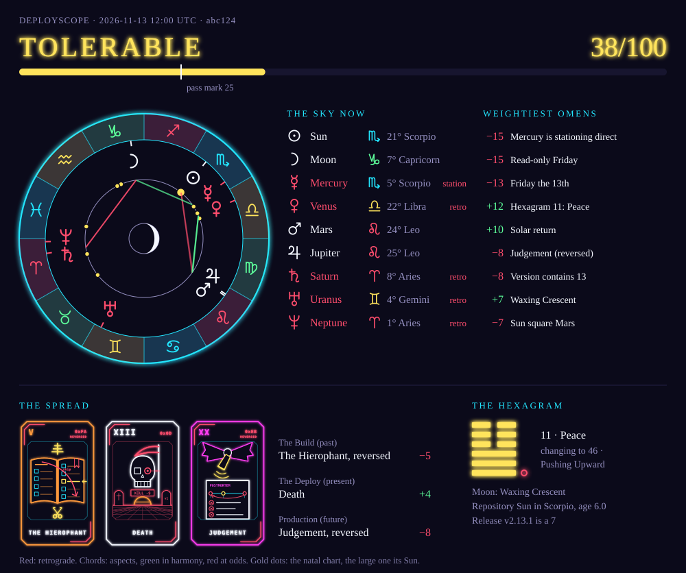
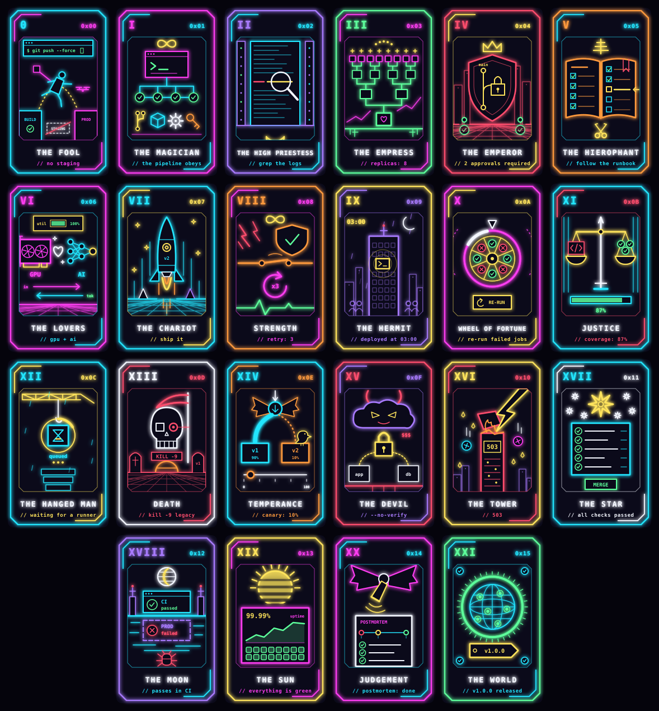
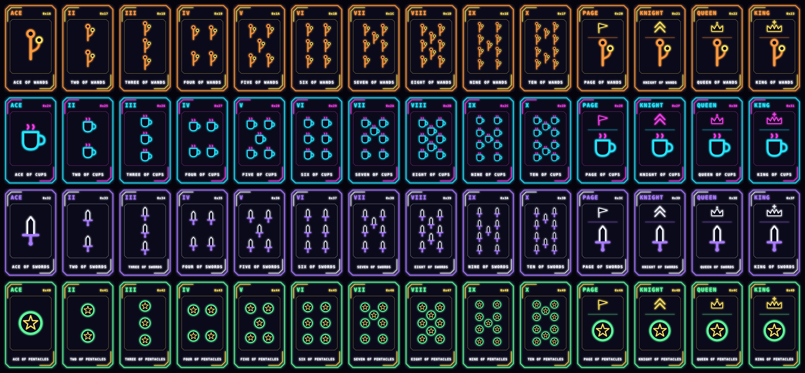

# deployscope

Your deployment horoscope: a GitHub Action that decides whether you may deploy
by reading the planets, the repository's natal chart, a tarot spread, an
I Ching hexagram and, for tagged releases, the numerology of the version.

The astronomy is real. The conclusions are not. Everything in between is
deterministic, tested, and reported as ordinary CI errors.

```
Error: OMEN001 Mercury is retrograde
  Mercury rules networking, DNS and message queues, and it is moving backwards
  through Cancer. Messages will be lost, duplicated, or delivered to the wrong
  environment. (-25)
Error: OMEN011 The Moon is void of course
  The Moon makes no further aspect before it enters Gemini around 2026-07-10
  23:00 UTC. Nothing begun under a void Moon comes to anything: the deploy will
  succeed and change nothing, or be rolled back. (-12)
Error: OMEN031 Read-only Friday
  No planet forbids a Friday deploy; the elders of operations do. Whoever ships
  today owns the weekend. (-15)
Error: OMEN500 Verdict
  ILL-OMENED: the heavens advise against this deployment (score 1/100, required 25).
  The next favourable window opens around 2026-07-13 00:00 UTC (score 28).
  Re-running before then will not help: the cards and the hexagram are bound to
  the commit.
```



## Usage

```yaml
jobs:
  deploy:
    runs-on: ubuntu-latest
    steps:
      - uses: actions/checkout@v7
      - uses: mooracle/deployscope@v1
        with:
          timezone: Europe/Berlin
      - run: ./deploy.sh   # only reached when the omens allow it
```

Advisory mode, using the outputs yourself:

```yaml
      - id: oracle
        uses: mooracle/deployscope@v1
        with:
          defy-fate: true
      - if: steps.oracle.outputs.verdict == 'ill-omened'
        run: echo "come back at ${{ steps.oracle.outputs.next-window }}"
```

On pull requests the reading is also posted as a comment, laid out like a
deployment bot's: one row with the status, score, spread and hexagram, and the
full reading (card and hexagram pictures, every omen) folded under it. Give the
job permission to do so:

```yaml
    permissions:
      contents: read
      pull-requests: write
```

### Inputs

| Input | Default | Meaning |
| --- | --- | --- |
| `seed` | the commit (on pull requests, the head commit) | What the cards and hexagram are cast for. Same seed, same casting. |
| `time` | now | ISO 8601 moment to read the sky for. |
| `timezone` | `UTC` | IANA time zone that decides which weekday it is. |
| `born` | repository creation time | Birth moment for the natal chart, ISO 8601 or Unix seconds. |
| `birthplace` | empty | Where the repository was born, as `latitude, longitude` in degrees (`59.33, 18.07`). Gives the natal chart an ascendant and houses. |
| `version` | tag name on tag builds | Release version for numerology. Empty on branch builds, so numerology applies to tagged releases only. |
| `fail-below` | `25` | Fail the job when the score is below this. |
| `defy-fate` | `false` | Report everything, never fail. |
| `comment` | `true` | On pull requests, post the reading as a comment. One comment per pull request, rewritten on every run. |
| `publish-branch` | empty | Branch to commit the reading's SVG to, so the chart wheel appears in the comment. Needs `contents: write`. |
| `github-token` | `github.token` | Token for the comment and for publishing. |

`born` comes from the event payload, which scheduled runs do not carry; set it
explicitly there, or the natal chart is skipped.

### Outputs

| Output | Meaning |
| --- | --- |
| `verdict` | `auspicious`, `tolerable` or `ill-omened` |
| `score` | 0-100 |
| `cards` | the three cards drawn |
| `hexagram` | the hexagram cast, and the one it changes to |
| `mercury-retrograde` | `true` while Mercury moves backwards, stations included |
| `moon-phase` | current lunar phase |
| `moon-void` | `true` when the Moon is void of course |
| `sun-sign` | the repository's Sun sign |
| `rising-sign` | the sign rising at the repository's birth, when `birthplace` is set |
| `release-number` | numerological number of the version, on tagged releases |
| `next-window` | when ill-omened, the hour at which the verdict next improves |
| `reading-svg` | path of the reading drawn as an SVG, for `actions/upload-artifact` |
| `reading-url` | URL of the published SVG, when `publish-branch` is set |

### Exit codes

`0` deploy permitted, `1` ill-omened, `2` the oracle could not be consulted
(invalid input).

## Pictures

Every run draws the reading as one SVG: the verdict and the score against the
pass mark; the chart wheel (the sky now, aspects as chords, the natal chart as
gold dots, retrograde planets in red, the Moon's phase in the middle) with the
same positions as a table beside it; the omens that weigh most; the three
cards; and the hexagram with its changing lines. Planet and sign glyphs are
drawn as paths, not taken from a font, so the picture looks the same
everywhere. Its path is the `reading-svg` output.

GitHub does not render inline SVG in comments or job summaries, only images
with a URL, so the comment gets its pictures two ways:

- **Cards and hexagrams** are static files in this repository's `assets/`
  directory, linked at the ref the action is used at. No extra permission, but
  the action's repository has to be readable by whoever views the comment.
- **The chart wheel** is different on every run. Set `publish-branch` (for
  example `deployscope-readings`) and the SVG is committed to that branch and
  embedded in the comment. The branch is created as an orphan if missing and
  gains one file per run.

A failure to comment or publish is a warning (`OMEN450`, `OMEN451`), never a
failed job: pull requests from forks get a read-only token.

## Theoretical basis

**1. The sky is computed, not looked up.** Planetary positions come from JPL's
Keplerian elements ("Approximate Positions of the Planets", valid 1800-2050):
solve Kepler's equation for each planet and for Earth, subtract, and take the
geocentric ecliptic longitude, corrected for precession to the tropical
zodiac. The Moon uses the truncated Astronomical Almanac series. Accuracy is a
few arcminutes for planets and about 0.3° for the Moon, which is far better
than the interpretation deserves. No network, no dependencies.

**2. Retrograde is a sign change in a derivative.** A planet is retrograde when
its geocentric longitude is decreasing (central difference over one day).
Mercury moving slower than 0.2°/day is "stationary": the turning point of the
cycle and its most intense moment. Stationing retrograde (speed still falling)
is the worst case (-30, against -25 mid-retrograde); stationing direct (speed
rising) is the mildest (-15), since the retrograde is ending.

**3. Doctrine of correspondences.** Each body governs a part of the pipeline:

| Body | Governs |
| --- | --- |
| ☉ Sun | the main branch |
| ☽ Moon | the on-call mood |
| ☿ Mercury | networking, DNS and message queues |
| ♀ Venus | the UI and user affection |
| ♂ Mars | hotfixes and force pushes |
| ♃ Jupiter | scaling and capacity |
| ♄ Saturn | tech debt and compliance |
| ♅ Uranus | sudden outages and shiny rewrites |
| ♆ Neptune | caches, mocks and other illusions |
| ♇ Pluto | deletions and migrations that cannot be undone |

**4. Aspects, dignities and combustion.** Two bodies near an angle of 0°, 60°,
90°, 120° or 180° are in aspect. The orb within which an aspect is felt is
graded by its strength: 6° for conjunctions and oppositions, 5° for squares and
trines, 3° for sextiles. Sextiles and trines are harmonious (+4, +6 with a
benefic: Venus, Jupiter). Squares and oppositions are hard (-4, -7 with a
malefic: Mars, Saturn, Uranus, Pluto). Conjunctions take the nature of the
planets involved. An aspect still closing (*applying*) is about to happen and
counts in full; one past exact (*separating*) is spent and counts half.
Aspects between two slow planets (Jupiter and beyond) last for months and are
ignored, since they are nobody's deploy's fault. Sun-Moon aspects are the lunar
phase and are judged there, not twice.

A planet within 8° of the Sun is not conjunct but *combust*: burnt up in the
Sun's rays and out of sight (-3). Within 17 minutes of arc it is *cazimi*, in
the heart of the Sun, and for a few hours strongest of all (+6).

Each of the seven classical planets also has its *essential dignity* by sign:
in the sign it rules it is at home (+4, Mercury in Gemini or Virgo), in its
exaltation an honoured guest (+3, the Sun in Aries), in detriment opposite its
own sign it works against itself (-4, Mars in Libra), and in fall it is weak
(-3, Saturn in Aries, which lasts until 2028). The strongest one applies.

**5. Time.** Each weekday has its classical planetary ruler and takes its
character from it; Thursday (Jupiter) is best. A day whose ruler is retrograde
or stationary works against you. Friday belongs to Venus, a benefic, so the
no-deploy rule is not hers: it is scored separately as operational custom
(`OMEN031`, and `OMEN032` for the weekend). The lunar phase is the Sun-Moon
elongation. As in electional astrology, the dark Moon is against beginnings
(-6), the first crescent after it is the best time to start something (+7),
the rest of the waxing Moon favours shipping, full moon raises incident risk,
and the waning Moon favours deleting code.

**6. Void-of-course Moon.** From electional astrology, the branch concerned
with choosing when to begin things. The Moon is void when it will complete no
further major aspect to any body before leaving its sign, and what is begun
then "comes to nothing". It is found by stepping the Moon forward in half-hour
steps to the sign boundary and looking for an exact aspect on the way. With
nine bodies to aspect, the Moon is void about a fifth of the time.

**7. Natal chart.** The repository is born when it is created; its chart is
the sky of that moment and its Sun sign gives its character. The reading then
becomes personal, so two repositories get different verdicts at the same
instant:

- *Transits*: today's planets against the natal Sun (the repository's core
  purpose), Moon (its users' habits) and Mercury (its APIs), scored like
  aspects by the nature of the transiting planet. The orb is 3° for the fast
  planets and 1.5° for Jupiter and beyond, which linger for weeks and only
  count when nearly exact.
- *Solar return*: the Sun back at its natal place, the repository's birthday
  (+10, good for a major version).
- *Lunar return*: the Moon back at its natal place, every 27 days (+4).
- *Jupiter return*: Jupiter back at its natal place, every twelve years (+8,
  a year of growth begins).
- *Saturn cycle*: Saturn square or opposite its natal place, roughly every
  seven years (-8), and the Saturn return near 29.5 years (-15, time for the
  rewrite).
- *Ascendant and houses*: these depend on where the chart is cast for, and a
  repository has no birthplace unless you give it one (`birthplace`). With
  one, the rising sign is computed from the local sidereal time, transits to
  the ascendant (the repository's public face) are read, and houses are
  counted in whole signs from it: Venus or Jupiter passing through the sixth
  house (daily toil: the pipeline) or the tenth (public standing: production)
  helps (+3), Mars or Saturn there does not (-3).

**8. Tarot.** Three cards are drawn without replacement from the full deck of
78 for Build (past), Deploy (present) and Production (future), upright or
reversed, from SHA-256 of the seed. The positions do not weigh the same: the
past is half spent and counts half, the outcome is what was asked about and
counts one and a half times.
Each major arcanum is drawn as what it means in software delivery, not as the medieval
scene: the Fool jumps the gap where staging should be, the Lovers are a model
and its GPU, Justice weighs code against tests, the Moon is a build that is
green in CI and red in its reflection. A reversed card is not turned upside down: it is
redrawn as the same scene after its meaning has turned. The Star's green
checklist becomes a column of question marks under a `NO DATA` button, the
Lovers' heart breaks and the GPU reads `OOM`, the Devil's padlock opens. The
card is marked `REVERSED`, the byte in its corner has every bit flipped (the
Star's `0x11` becomes `0xEE`). A card carries only its number and name; what
it says about this deployment is in the reading beside it.



The 56 minor arcana are pip cards, as in the old decks: as many suit emblems
as the card's number, and an insignia of rank for the court cards. Wands (will
and new work) are branches, Cups (people: the team and the users) are mugs,
Swords (the mind and its conflicts: review and incidents) are swords, and
Pentacles (the material world: infrastructure and money) are coins. Reversed,
every emblem is turned over and goes red.



**9. I Ching.** A hexagram is six binary lines, so it is the oracle native to
the medium. It is cast by the three-coin method with one hash bit per coin:
each line comes out 6, 7, 8 or 9 with the traditional odds of 1:3:3:1. Lines of
6 and 9 are "old" and change into their opposite, giving a second hexagram for
where the situation is heading. How much each weighs follows the number of
changing lines, after Zhu Xi: with one or two the present hexagram governs
(the future counts a quarter), with three the two are read together (three
quarters each), with four or five the future governs (the present counts a
quarter), with six the present has turned over completely. Hexagrams are
looked up by trigram pair in the King Wen sequence, and scored by their
judgment: "it furthers one to cross the great water", the classical phrase for
a large undertaking, is read as leave to deploy.

**10. Numerology, for tagged releases.** The digits of the version are summed
and reduced to a single digit, except for the master numbers 11, 22 and 33:
`v2.4.1` is a 7. Each number has a character (1 beginnings, 4 foundation,
5 restless change, 8 success, 9 endings). A sum that passes through 13, 14,
16 or 19 on its way down carries a *karmic debt* from earlier releases (-6):
`v9.4` sums to 13 before it becomes a 4. A version component that is literally
13 carries its own penalty, by superstition and not by numerology.

**11. Fate and free will.** Cards, hexagram and release number derive from the
commit and the tag, so they are properties of the thing being deployed:
re-running the job cannot re-roll them. The sky moves, so the same commit can
legitimately get a different answer later.

**12. Verdict and the next window.** Start from 80 (baseline optimism), add
every omen's delta, clamp to 0-100. Below `fail-below` (default 25) is
`ill-omened` and fails the job; 90 and above is `auspicious`; in between is
`tolerable`. The defaults are calibrated so that roughly one deployment in ten
is refused; which one is up to the stars. Every
omen is printed with its delta, so any verdict can be audited line by line.
A refused deployment is told when to come back: the same question is asked
again for every hour of the next 14 days, and the first hour that passes is
reported in the error and in the `next-window` output.

In simulation with the defaults (natal chart on, no birthplace, no release
tag), 10.7% of deployments are refused in 2026, 15.7% in 2027, 9.6% in 2028
and 8.7% in 2029; about 10% are auspicious and the rest tolerable. Some years are simply worse
than others.

### Error codes

| Code | Meaning |
| --- | --- |
| `OMEN001` | Mercury retrograde (-25) |
| `OMEN002` | Another planet retrograde |
| `OMEN003` | Mercury stationing retrograde (-30) or direct (-15) |
| `OMEN010` | Lunar phase |
| `OMEN011` | Moon void of course (-12) |
| `OMEN013` | Friday the 13th |
| `OMEN020` | Planetary aspect |
| `OMEN021` | Planet combust, too close to the Sun |
| `OMEN022` | Planet cazimi, in the heart of the Sun |
| `OMEN030` | Planetary ruler of the weekday |
| `OMEN031` | Read-only Friday (custom, not astrology) |
| `OMEN032` | Weekend deploy (custom, not astrology) |
| `OMEN040` | Transit to the natal chart |
| `OMEN041` | Solar return |
| `OMEN042` | Lunar return |
| `OMEN043` | Saturn cycle or Saturn return |
| `OMEN044` | Jupiter return |
| `OMEN045` | Planet in the sixth or tenth natal house (needs `birthplace`) |
| `OMEN050` | Essential dignity: domicile, exaltation, detriment or fall |
| `OMEN100`-`OMEN177` | Tarot card (0-21 the major arcana, then Wands, Cups, Swords, Pentacles) |
| `OMEN200` | Verdict: deploy permitted |
| `OMEN299` | Verdict: ill-omened, but fate was defied |
| `OMEN301`-`OMEN364` | I Ching hexagram (King Wen number) |
| `OMEN400` | Invalid input |
| `OMEN450` | The comment could not be posted (warning) |
| `OMEN451` | The reading could not be published (warning) |
| `OMEN500` | Verdict: ill-omened |
| `OMEN601`-`OMEN633` | Release number |
| `OMEN613` | Version contains 13 |
| `OMEN640` | Karmic debt number |

## Development

```sh
npm test                                   # node --test, no dependencies
npm run divine                             # consult the oracle for right now
npm run assets                             # regenerate assets/ after changing src/svg.js
INPUT_TIME=2026-07-10T12:00:00Z INPUT_SEED=1197955 \
  INPUT_BORN=2020-11-13T09:00:00Z INPUT_VERSION=v2.4.1 npm run divine
```

Layout:

- `src/ephemeris.js`: planetary positions, retrogrades, void-of-course Moon
- `src/natal.js`: the repository's birth chart
- `src/tarot.js`, `src/iching.js`, `src/numerology.js`: the other oracles
- `src/omens.js`: rules, scoring, verdict, next-window forecast
- `src/report.js`: log, annotations and job summary
- `src/svg.js`: drawings; `scripts/build-assets.js` writes the static ones to `assets/`
- `src/arcana.js`: the 22 card scenes, each drawn on its own as neon line art, and the pip cards
- `src/comment.js`, `src/github.js`: the pull request comment and the API calls behind it
- `src/main.js`: action entry point

## Disclaimer

Not a substitute for tests, staging, or a rollback plan. Planets do not read
your changelog.

## Who made this

[Mooracle](https://mooracle.io/?utm_source=github&utm_medium=readme&utm_campaign=deployscope).
On working days we review architecture and codebases for founders and
investors, by methods with a somewhat better track record than this one.
